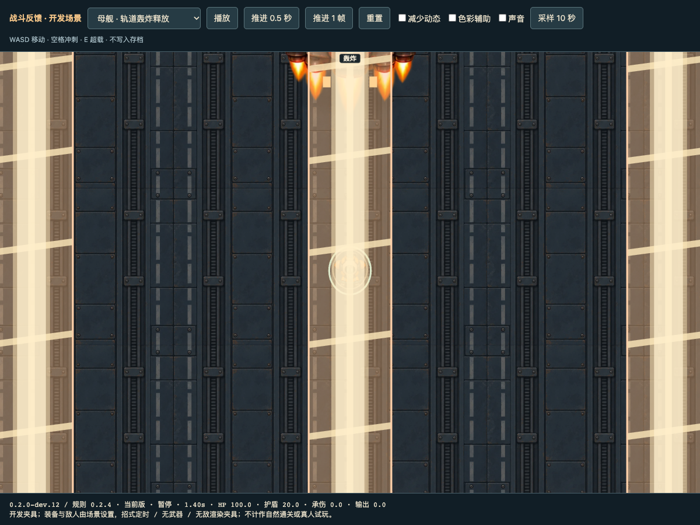
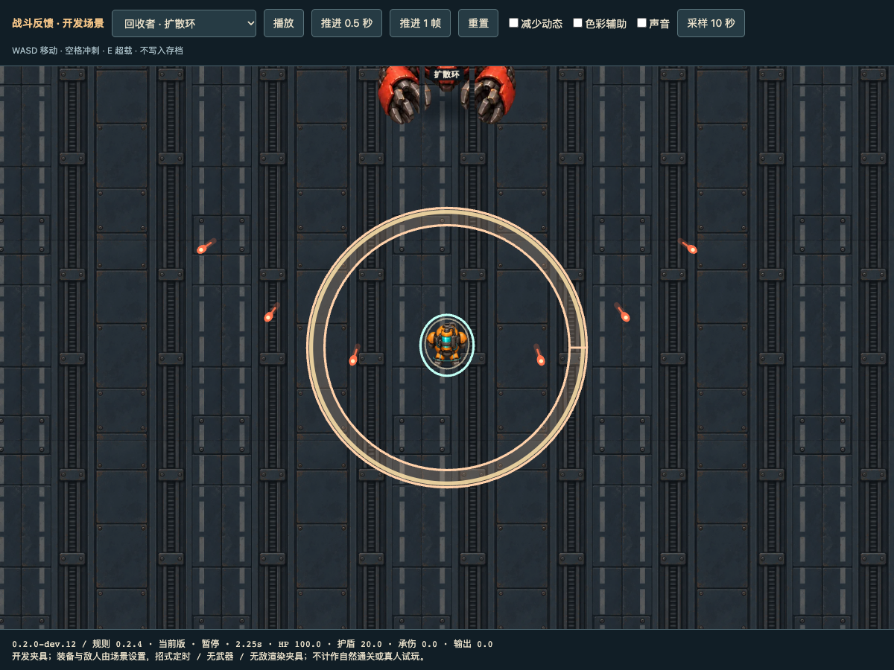

# dev.12：Boss 压力、敌方伤害与攻击反馈

版本 `0.2.0-dev.12`，规则 `0.2.4`。对照基线为提交 `0850931`（dev.11）。源码和 `dist/` 已更新，本批未推送或部署。

## 难度调整

- 六个 Boss 的基础生命提高30%：第一章1100→1430，第二章2600→3380，第三章4800→6240。双子和母舰继续共享生命池。
- Boss 接触、招式、弹丸、残留火地和母舰护航机伤害提高50%。例如重砸18→27、轨道轰击24→36、火地每跳6→9；母舰护航机8→12。原有难度倍率只叠加一次。
- 小怪的非零基础伤害提高约35%，取整数：拾荒螨8→11、钉虫6→8、重装搬运工14→19、自爆电池18→24、清道夫22→30。维修球远程脉冲6→8。
- Boss 第一阶段基础弹速、冲锋和扩散环速度提高12%；后续阶段继续叠加阶段/难度/狂暴增幅。提高追击速度，常规后摇缩短20%，下限0.4秒。冲锋加速同时缩短持续时间，保持行进距离落在预警路线内。
- 压路王重砸半径185→220并追加5/7发扇形弹；起重机磁吸速度85→110、砸击半径150→165，磁吸期间追加5/7发弹。
- 熔炉蟹喷流半径300→360，踏地追加锁定玩家当前落点的炮击，给出独立1.1秒预警。
- 双子电缆追加玩家落点放电圈，召唤电池时追加5/7发扇形弹。回收者和母舰沿用原有组合，受统一伤害、速度与后摇调整影响。

保留完整预警、摆锤内圈安全区、母舰轰炸通道与60度弹幕缺口。没有增加怪物上限；受击保护0.35秒、成功接触后1秒冷却以及冲刺无敌仍生效。图鉴数据与招式说明同步更新，原始设计基线不改写，当前数值由 `assets/source/combat-balance-dev12.json` 和 `boss-guide-dev12.json` 提供。

## 反馈及补充修复

攻击释放事件保存形状、宽高、角度和内圈半径，解决持续时间只有0.12–0.15秒的攻击在危险区域移除后缺少反馈的问题。条带轰炸有光柱、扇形重击有扇面冲击线、冲锋有方向能量线、冲击环有高亮伤害边缘；火地、炮击、牵引、传送带、召唤和弹幕都有释放反馈与对应音效。绘制沿用预警几何并裁切，避免特效填满摆锤安全内圈。减少动态模式保留静态反馈。

特效保持短生命周期、固定数量笔画与既有240个效果上限；音效延续播放节流。增加狂暴预告/触发画面，狂暴后的 HUD 改为“狂暴过载中”。

另修复两个实际规则问题：

- 敌人碰到冲刺或无敌中的角色时，只有真正造成伤害才开始接触冷却，避免无伤碰撞意外赠送额外1秒保护。
- 维修球的合法零接触伤害此前被 `|| 20` 替换成20。现在保留零接触伤害，通过可预警的强化脉冲进攻。

## 验证

- `npm run check`、`npm test`、`npm run build`、`npm run bundle:check`通过；166/166项测试通过。新增覆盖无敌接触冷却、伤害倍率、持续火地、短暂轰炸事件保存恢复、所有真实 Boss 招式的绘制/音效，以及安全内圈。既有测试继续覆盖最高难度弹幕数量上限、预警、冲锋路线、角色技能与旧存档兼容。
- 同一个10 Hz可见状态自动驾驶策略，6 Boss × 6训练预设 × 精良/传说装备，共72组前后对照。两版本都在缺少至少6生命时使用拾荒者 Q，使用真实装备规则，未修改练习 HP 或无敌时间。通过数67→59；精良32/36→26/36，传说35/36→33/36；平均承伤77.26→125.47（约+62%）。这是机器固定装备对照，不是玩家胜率或商店获取保证。原始记录：`qa/dev12-boss-pressure.json`。
- 6次自然成长冒烟模拟：使用正常购买、奖励、装配和战斗接口，5次通关、1次在第8战失败，无异常；68次存档恢复与不中断分支对照一致。该旧自然驾驶策略不使用 Q。见 `qa/natural-probe-dev12-smoke.json` 及对应压缩原始记录。
- 独立无痕、无头 Chrome 检查7种招式画面和减少动态/色彩辅助。实际试炼场使用拾荒者、仅铆钉枪挑战母舰：轨道轰击36伤害先扣20盾，再扣16生命；Q修复6，暂停冻结计时。390×844视口检查与刷新返回主页通过，无页面异常。见 `qa/dev12-browser.json`、`qa/dev12-practice-mobile.png`。
- 同一无头桌面浏览器、1200×900视口、1秒预热后采样10秒：母舰最终阶段绘制 P95约1.3→1.4 ms，40敌人场景约1.7→1.8 ms。场景分别使用无敌和10000生命保持运行；这不是手机帧率，也不是自然战斗的性能结论。没有新增大图资源，静态包仍约1.77 MiB。





## 复现

```sh
node --experimental-strip-types scripts/boss-pressure-probe.ts --baseline=/path/to/dev11/game --output=qa/dev12-boss-pressure.json
node --experimental-strip-types scripts/natural-probe.ts --seeds=1 --policy=expanded --output=natural-probe-dev12-smoke.json
PORT=4202 MECHA_BASELINE=/path/to/dev11/game node scripts/serve-feedback.mjs
# 另一终端；使用本机已安装的 Playwright 和 Chrome，可通过环境变量指定：
PLAYWRIGHT_MODULE=/path/to/playwright/index.mjs CHROME_PATH=/path/to/chrome node scripts/dev12-browser.mjs
```

测试页不写入远征存档，正式入口为同源 `/game/`。旧战斗快照保留其中已生成的生命、伤害及排队招式，后续生成的攻击/敌人应用新规则；完整新数值可在新战斗或试炼场体验。真人难度反馈、声音听感与手机持续帧率仍需实测。
